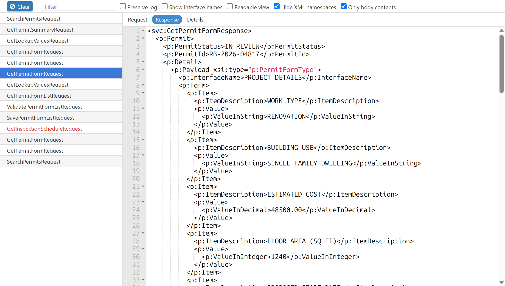
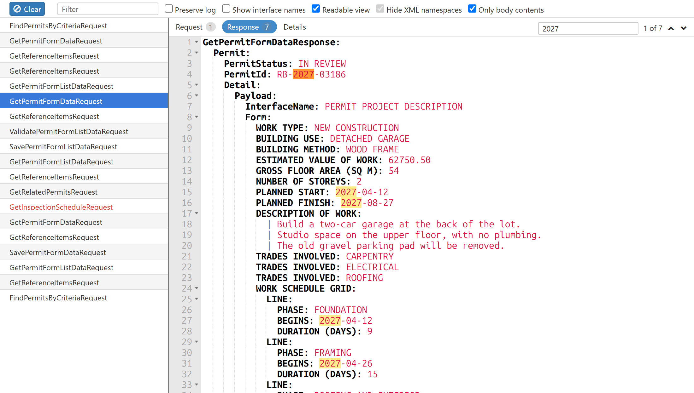
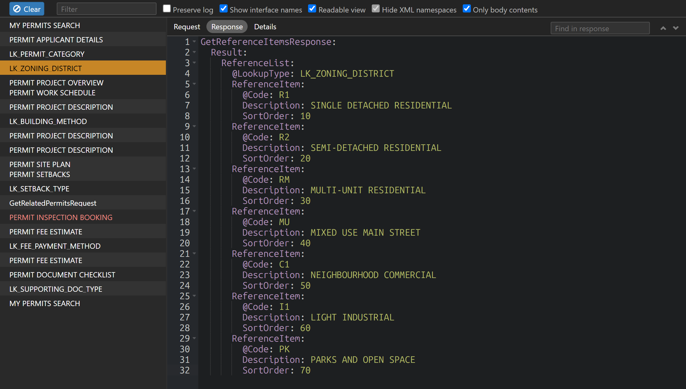

# Soap Analyzer

A developer tools extension for Chrome and Microsoft Edge that tracks the SOAP HTTP requests made by the browser. It works like the Network tab, but only for SOAP traffic.

This is a fork of [DJ Collier](https://github.com/collier)'s original [soap-analyzer](https://github.com/collier/soap-analyzer). It moves the extension to Manifest V3 and adds the features listed under [Changes in this fork](#changes-in-this-fork).

## Features

- Lists SOAP web service calls by service name instead of by URL.
- Parses the XML request and response of each call, and shows them in a [text editor](https://ace.c9.io/) with collapsible nodes and syntax highlighting.
- Can hide the Envelope, Header, and Body tags, to focus on the content of requests and responses.
- Can hide 'xmlns' attributes on XML nodes to cut the clutter.

## Changes in this fork

- **Readable view:** shows requests and responses as indented `name: value` lines instead of XML, without namespaces. Form items are listed by their description (`ItemDescription`) and value, with nested item lists indented below them.
- **Show interface names:** lists calls by the `InterfaceName` elements in their requests instead of by service name. `GetReferenceItemsRequest` calls are listed by their `LookupType` instead. Calls without either keep their service name.
- **Filter box** to search the list by name.
- **Find in requests and responses:** a find box next to the tabs highlights every match in the request and response text, and steps through them with Enter and Shift+Enter (or the arrow buttons). Each tab shows how many matches it has, and Ctrl+F (Cmd+F on a Mac) jumps to the box.
- **Resizable list:** drag the divider between the list and the editor.
- **Failed calls in red:** calls with an HTTP error, or no response, are highlighted in the list.
- **Preserve log:** like the Network tab, the list clears when the page navigates unless 'Preserve log' is checked.
- **Follows the DevTools theme:** switches between light and dark on its own, in place of the old dark theme setting.
- **Manifest V3:** runs in current versions of Chrome and Edge, with an updated build (webpack 5, Babel, and plain CSS in place of Sass).
- **Fixes:**
  - The service name is found when the SOAP Body has attributes (from [André Stösel's pull request](https://github.com/collier/soap-analyzer/pull/13)).
  - The body is found whatever the envelope's namespace prefix (`soap:`, `soapenv:`, ...).
  - SOAP requests are detected over HTTP/2, which lowercases header names.

These also close issues [#6](https://github.com/collier/soap-analyzer/issues/6), [#9](https://github.com/collier/soap-analyzer/issues/9), [#10](https://github.com/collier/soap-analyzer/issues/10), [#11](https://github.com/collier/soap-analyzer/issues/11) and [#12](https://github.com/collier/soap-analyzer/issues/12) from the original repo.

## Screenshots

The screenshots use made-up sample data.

A form response as XML, with namespaces hidden and only the body shown. Failed calls are red in the list.

The same response in the readable view.

Calls listed by their interface names, in the DevTools dark theme. A call with two forms lists both.

## Installation and Development

Soap Analyzer is built using webpack, clone the repo, run `npm install`, then run `npm start` to launch the dev environment, which watches for file changes and rebuilds. The `build/dist` folder can be loaded as an unpacked extension:

- **Chrome:** visit `chrome://extensions`, enable Developer mode, click "Load unpacked" and select `build/dist`.
- **Edge:** visit `edge://extensions`, enable Developer mode, click "Load unpacked" and select `build/dist`.

Running `npm run build` will create a zip file in a `./build/packages` directory, which is deployable to the Chrome Web Store and Microsoft Edge Add-ons.

## Support for other browsers

The extension uses Manifest V3 and works in Chrome and Microsoft Edge (and other Chromium-based browsers, version 88+).

## License

MIT License
